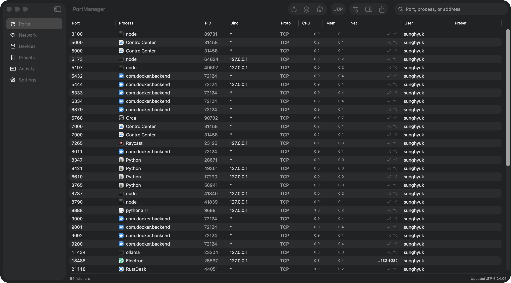
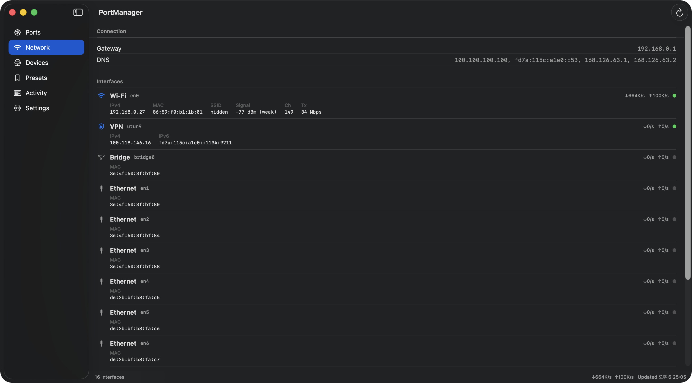
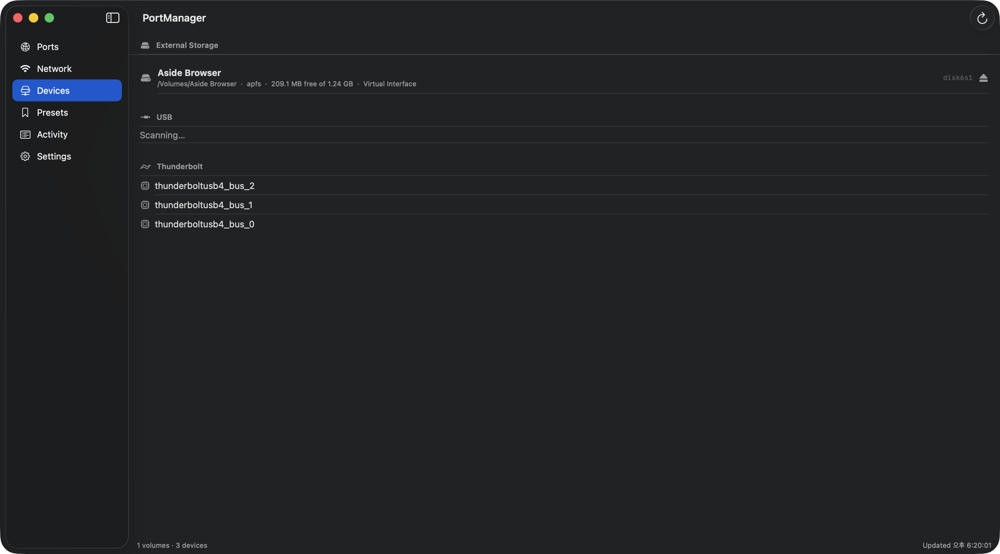

<p align="center">
  
</p>

# PortManager

**개발 서버의 네트워크 포트와 외장 스토리지·USB·Thunderbolt 장치를 한곳에서 관리하는 macOS 앱.**

Orca에서 여러 프로젝트와 코딩 에이전트 세션을 다루다 보면, 어떤 개발 서버가 아직 살아 있고 어느 포트를 점유했는지 확인할 일이 많아진다. 외장 SSD를 사용할 때도 연결 상태, 남은 공간과 안전하게 꺼낼 수 있는지를 여러 화면에서 살펴봐야 했다. PortManager는 이 확인과 정리 과정을 메인 창과 메뉴바에 모은 개인 유틸리티다.



## 주요 기능

| 영역 | 기능 |
|---|---|
| 포트 조회 | TCP 리스너, 선택적 UDP·연결 소켓 조회, 검색·정렬·localhost 필터, CSV 내보내기 |
| 프로세스 확인 | 실행 경로, 시작 시각, CPU·메모리, 자식·부모 프로세스, 프로세스별 소켓 묶음 |
| Docker | 사용 가능한 Docker CLI와 데몬을 통해 published 호스트 포트의 컨테이너·이미지 표시 |
| 종료 | 대상 프로세스 신원 재확인 후 SIGTERM, 응답하지 않으면 명시적 SIGKILL 선택 |
| 프리셋·알림 | 포트·프로토콜·예상 프로세스 규칙, 기존 충돌과 새 리스너 감지, 대역폭 임계값 알림 |
| 네트워크 | 인터페이스별 주소·송수신 속도, 게이트웨이·DNS, Wi-Fi 정보 |
| 장치·스토리지 | USB·Thunderbolt 트리, 외장 볼륨의 마운트 경로·파일 시스템·용량 |
| 꺼내기 | 장치의 볼륨을 언마운트한 뒤 eject, 실패 원인·점유 프로세스·재시도 표시 |
| 활동 기록 | 최근 이벤트와 일별 JSONL 기록, 보관 기간 설정·삭제 |
| 메뉴바 | 리스너 수, 프리셋 상태와 외장 볼륨 확인, 메인 창과 동일한 종료·꺼내기 흐름 |

<details>
<summary>Network·Devices 화면 보기</summary>

### Network



### Devices



캡처 당시에는 디스크 이미지와 Thunderbolt 버스가 표시되어 있다. 외장 SSD를 연결해 촬영한 화면은 아니다.

</details>

## 요구 사항

- macOS 15 이상
- Swift 6 이상을 제공하는 Xcode Command Line Tools
- Docker 연동을 사용할 경우 실행 환경의 `PATH`에서 찾을 수 있는 Docker CLI와 실행 중인 데몬

Xcode 프로젝트나 외부 Swift 패키지 의존성은 없다. 일반 포트·장치 조회에 Docker는 필요하지 않다.

## 소스에서 빌드하고 실행하기

Command Line Tools가 없다면 먼저 설치한다.

```sh
xcode-select --install
```

저장소를 받은 뒤 앱 번들을 빌드한다.

```sh
git clone https://github.com/jaymunsh/port-manager.git
cd port-manager
make build
open PortManager.app
```

`make build`는 release 바이너리와 리소스를 `PortManager.app`으로 묶고 로컬 개발용 ad-hoc 서명을 적용한다. 빌드된 앱을 `/Applications`로 옮겨 사용할 수도 있다.

**실행은 반드시 `.app` 번들로 한다.** 일반 앱 경로를 `.build/debug/PortManager` 같은 bare 바이너리로 실행하면 알림 센터 초기화 시 크래시할 수 있다. 아래의 `make test`는 앱 초기화를 건너뛰는 별도 테스트 경로다.

| 명령 | 동작 |
|---|---|
| `make build` | release 빌드와 `.app` 패키징 |
| `make debug` | debug 빌드와 `.app` 패키징 |
| `make run` | 빌드 후 실행 중인 PortManager 인스턴스를 종료하고 앱 재실행 |
| `make test` | debug 빌드 후 인바이너리 `--selftest` 실행 |
| `make clean` | 빌드 결과와 생성된 앱 번들 제거 |
| `./Scripts/make_icon.sh` | 앱 아이콘 재생성 |

현재는 소스에서 빌드하는 방식이다. 별도의 설치 패키지, 공증된 다운로드 빌드와 자동 업데이트는 제공하지 않는다.

## 사용 흐름

1. **Ports**에서 포트 번호나 프로세스를 검색하고, 행을 선택해 실행 경로와 부모 프로세스를 확인한다. 같은 포트가 여러 행에 보여도 IPv4·IPv6 또는 연결별 소켓일 수 있다.
2. 종료가 필요하면 **Terminate Process…**로 대상을 확인한 뒤 종료를 요청한다. 자주 쓰는 포트는 프리셋으로 저장하고 예상 프로세스를 지정해 충돌을 감시한다.
3. **Devices**에서 외장 볼륨과 연결 장치를 확인한다. 꺼내기는 같은 장치의 다른 볼륨에도 영향을 주므로 확인 창의 안내를 읽고 진행한다. 점유 프로세스가 표시되면 필요한 프로그램을 종료한 뒤 다시 시도한다.
4. **Network**에서 인터페이스·DNS·게이트웨이를, **Activity**에서 상태 변화 기록을 확인한다.

Settings에서 포트 자동 조회 간격을 `0`으로 설정하면 일시정지된다. 수동 새로고침은 계속 사용할 수 있다. 메뉴바 표시 설정은 앱을 다시 실행할 때 반영된다.

## 종료와 꺼내기의 동작 범위

- 프로세스 종료 전 PID, 생성 시각, 프로세스 이름과 실행 경로를 다시 확인한다. 신원을 확인할 수 없거나 대상이 바뀌었으면 신호를 보내지 않는다. 앱 자신과 보호 대상 시스템 프로세스도 차단한다.
- SIGTERM 이후에도 같은 프로세스가 살아 있을 때만 강제 종료 선택지를 보여 준다. 다른 사용자·root 프로세스의 권한을 자동으로 얻는 헬퍼는 없다.
- 꺼내기는 장치의 형제 볼륨까지 언마운트한 뒤 eject한다. 강제 옵션에서도 언마운트가 실패하면 eject로 넘어가지 않는다. 강제 언마운트는 저장하지 않은 작업에 영향을 줄 수 있다.
- Wi-Fi SSID 등 일부 정보는 macOS 권한에 따라 숨겨질 수 있다. SSD의 SMART·수명·성능 진단과 장치-볼륨 전체 연결도는 제공하지 않는다.
- 로그인 실행은 `SMAppService`를 사용한다. 로컬 개발용 서명이나 설치 위치에 따라 등록이 실패할 수 있으며, 오류는 설정 화면에 표시한다.

## 데이터 저장

프리셋, 알림 규칙과 활동 기록은 맥 안에 저장한다.

```text
~/Library/Application Support/PortManager/
├── presets.json
├── alerts.json
└── history/
    └── history-YYYY-MM-DD.jsonl
```

뷰 설정과 알림 옵션은 UserDefaults에 저장한다. 활동 기록은 기본 7일을 보관하고 최근 500개를 화면에 복원한다. Activity의 기록 지우기는 저장된 히스토리 파일에도 반영된다. 저장 경로의 개인 데이터는 이 저장소에 포함되지 않는다.

## 개발과 검증

```sh
make test
make build
```

이 프로젝트의 테스트 진입점은 `swift test`가 아니라 [SelfTest.swift](Sources/PortManager/SelfTest.swift)의 인바이너리 검사다. 파싱, 명령 타임아웃·취소, 포트 감시, 기록 복원, 수집 직렬화와 카운터 수명을 확인한다. 종료 대상 검사는 신호를 보내지 않고 수행하며, 꺼내기 순서는 주입된 언마운트·eject 결과로 검사한다.

테스트에는 실제 `lsof`를 조회하는 항목도 포함된다. 이 검사는 실제 작업 프로세스를 종료하거나 사용자 디스크를 테스트 목적으로 꺼내지 않는다. 위험한 동작의 모의 검사는 실제 디스크 환경의 통합 검증을 대신하지 않는다.

구조는 SwiftUI View → `@MainActor` Store → Service로 나뉜다. 포트 목록 수집과 시간이 걸리는 `nettop`은 별도 루프를 사용하고, 트래픽 수집은 화면이나 활성 알림 규칙에서 필요할 때 실행한다. 겹친 새로고침은 직렬화하고, 취소·타임아웃과 이전 옵션의 결과를 처리한다.

| 문서 | 내용 |
|---|---|
| [문서 목록](docs/README.md) | 전체 개발 문서 안내 |
| [아키텍처](docs/architecture.md) | Store·Service·View와 동시성 모델 |
| [빌드](docs/build.md) | SwiftPM, 앱 번들, 아이콘과 테스트 |
| [포트](docs/ports.md) | 소켓 모델, 조회, 프로세스 종료와 대역폭 |
| [장치](docs/devices.md) | DiskArbitration, 외장 볼륨과 꺼내기 |
| [모니터링](docs/monitoring.md) | 프리셋, 알림, 기록과 메뉴바 |
| [macOS·SwiftUI 함정](docs/pitfalls.md) | 개발 중 확인한 플랫폼 제약 |
